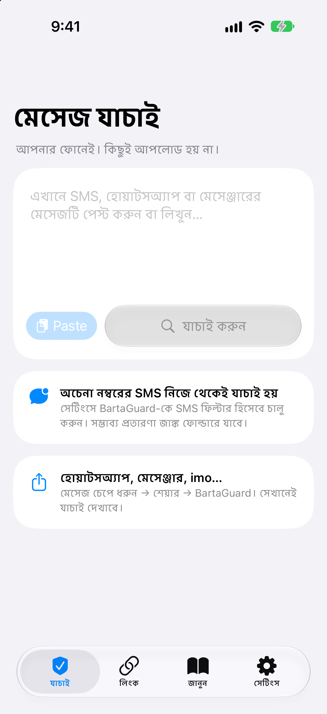
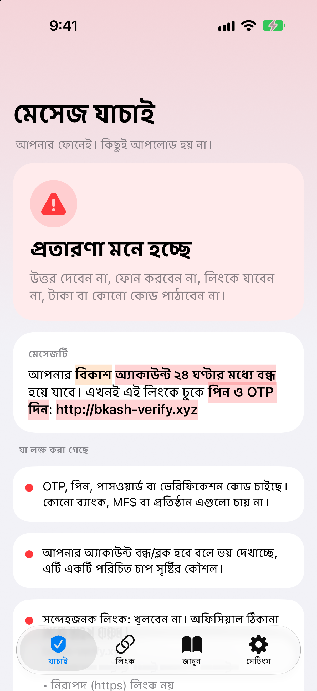
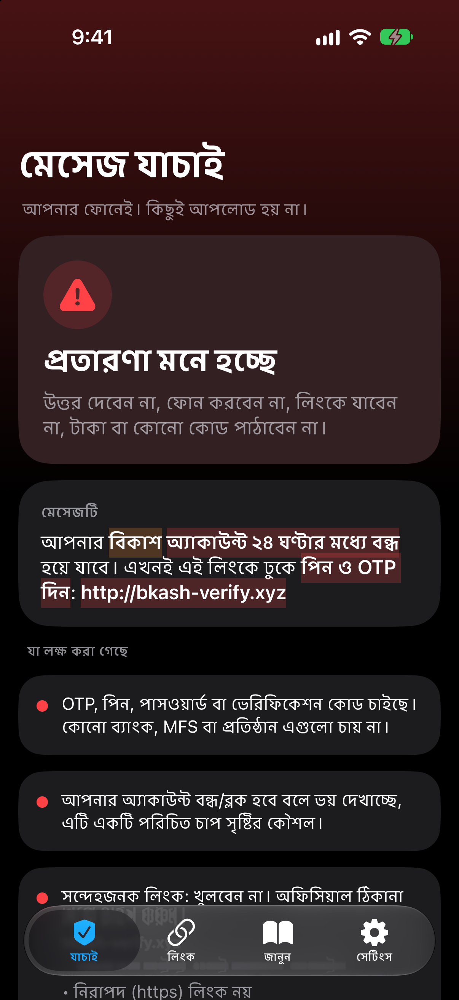
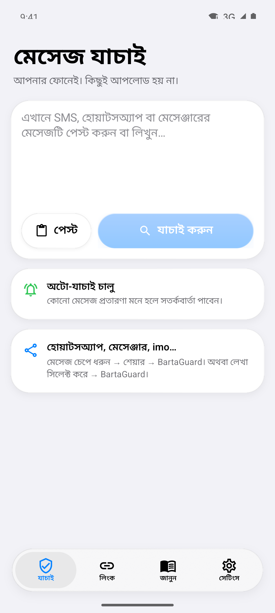
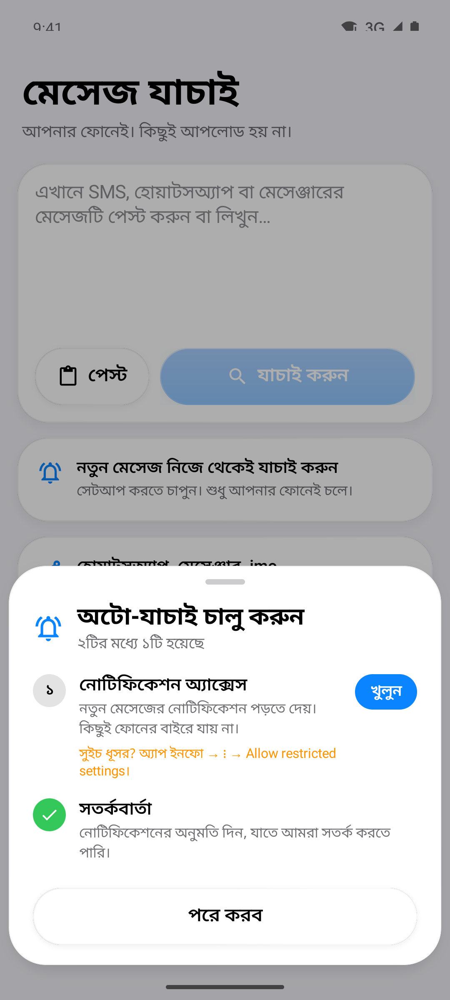
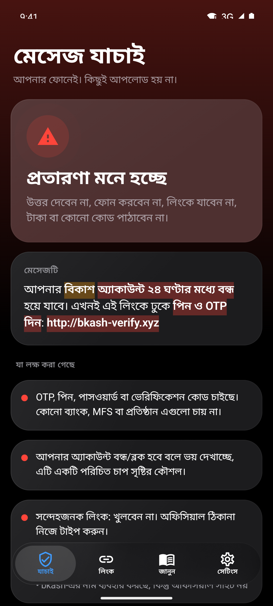
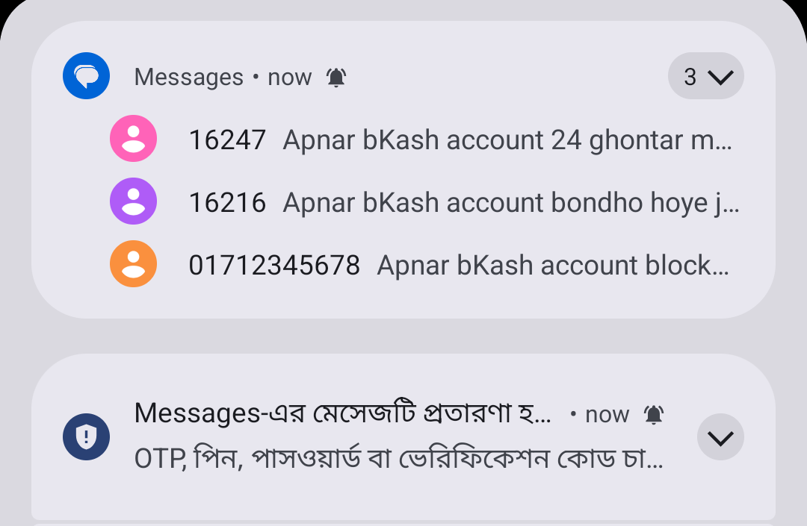
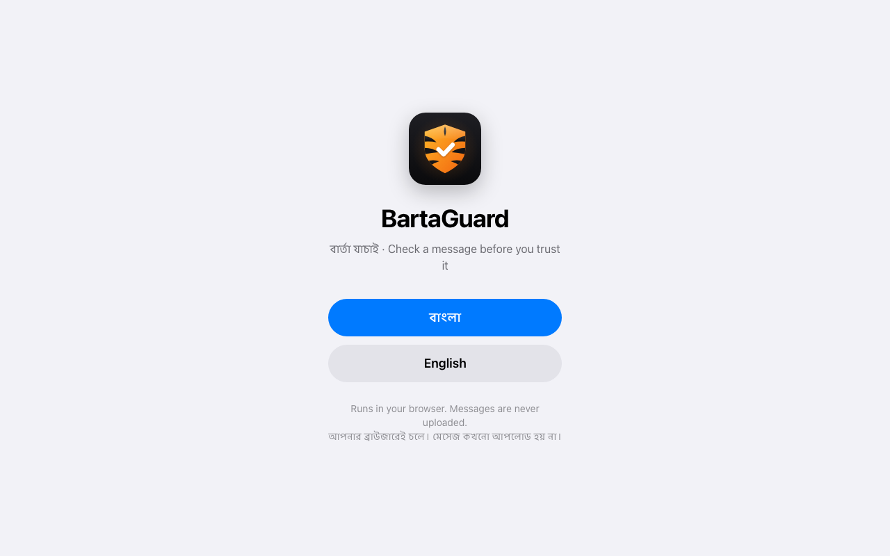

# BartaGuard

BartaGuard (বার্তাগার্ড) checks whether a Bangla SMS or chat message looks like a scam: fake OTP/PIN requests, "money sent by mistake" refund tricks, prize and job fees, threats that your account will be blocked, and dodgy links. It says what it found in plain Bangla or English and tells you what to do next.

Everything runs on the device. The phone apps have no network permission, and the website checks messages in the browser, so a message never has to leave your phone or computer.

| Part | What it does | Stack | Folder |
|---|---|---|---|
| iPhone app | Paste or share a message; **SMS filter** sends likely scams from unknown numbers to Junk | SwiftUI (Liquid Glass on iOS 26, iOS 17+), IdentityLookup, Share extension | `apps/ios` |
| Android app | Paste, share or select text; **opt-in auto-check** of new SMS/WhatsApp/Messenger/Telegram/imo notifications | Kotlin, Jetpack Compose, NotificationListenerService | `apps/android` |
| Website | Paste text or a **screenshot** (read on the device with OCR), link inspector | Next.js 15, TypeScript, tesseract.js | `apps/web` |
| API (optional) | Same checks for integrations | Python, FastAPI | `services/api` |
| Data and models | Audit, splits, training, export | pandas, scikit-learn, PyTorch | `ml/` |

It's a second opinion, not a guarantee. If you've already sent money or a code, call your bank's or mobile-money provider's official helpline straight away.

## Screenshots

<table>
  <tr>
    <td align="center"><br><sub>iPhone · check a message</sub></td>
    <td align="center"><br><sub>iPhone · scam found</sub></td>
    <td align="center"><br><sub>iPhone · dark mode</sub></td>
  </tr>
  <tr>
    <td align="center"><br><sub>Android · check a message</sub></td>
    <td align="center"><br><sub>Android · auto-check setup</sub></td>
    <td align="center"><br><sub>Android · scam found, dark</sub></td>
  </tr>
</table>

**Auto-check on Android:** a scam SMS arrives, and BartaGuard warns about it straight away, without the message leaving the phone.



**Website:** the same checks in the browser, plus reading text from a screenshot.



## Results

All numbers are on a held-out test split of 751 messages that was never used for training or for picking settings.

### What a user sees (model + red-flag rules combined)

| | All test messages | SMS only | Telegram only |
|---|---:|---:|---:|
| Scams marked **suspicious** | **90.0%** | 53.8% | 95.4% |
| Scams wrongly called **safe** (normal/promo) | **2.0%** | 15.4% | 0.0% |
| Legitimate messages marked suspicious | 10.7% | 8.6% | 52% (n = 21) |
| Messages answered "can't tell" | 9.3% | 10.9% | 6.7% |
| Accuracy when it does give an answer | 89.3% | 85.1% | 95.8% |

The SMS column is the weak spot, and it's also the column that matters most for the SMS filter. There are only 39 SMS scams in the test set, so those percentages are rough (one message is about 2.6 points).

### Text models alone (3 classes: normal / promotional / scam)

| Model | Test macro-F1 | SMS macro-F1 | Scam PR-AUC | Legit flagged as scam |
|---|---:|---:|---:|---:|
| Shortcut baseline (length, emoji, platform only) | 0.686 | 0.410 | 0.944 | 4.0% |
| **TF-IDF + logistic regression (shipped)** | **0.877** | 0.767 | 0.978 | 8.0% |
| TF-IDF + linear SVM (calibrated) | 0.889 | 0.782 | 0.976 | 5.3% |
| bangla-bert-base, fine-tuned | 0.891 (95% CI 0.866–0.915) | 0.782 | – | 5.3% |
| xlm-roberta-base, fine-tuned | 0.883 (95% CI 0.857–0.908) | 0.758 | – | 5.6% |

The two transformers were fine-tuned on an Apple M4 GPU (MPS). They don't beat the small TF-IDF model by more than the noise, so I ship the TF-IDF one: it's 1.8 MB, runs in well under a millisecond, and fits inside an iOS message-filter extension (about 12 MB peak memory). The logistic regression is shipped rather than the SVM because its probabilities come straight from the model and are simple to port to three languages. Its calibration error on test is 0.032.

### Hand-written challenge set (42 messages, Bangla / Banglish / English)

The text model alone gets 55% (LR) to 60% (SVM) right. It does worst on English and Banglish, where it tends to call almost anything a scam. With the rules added, all 20 scams are marked suspicious and 1 of 22 legitimate messages is wrongly flagged. **I wrote the rules while looking at this set**, so treat it as a sanity check, not an independent score.

## What I found in the data

The data is the [BTTC corpus](https://doi.org/10.17632/5wrm959d6f.1): 10,283 Bangla messages labelled ham / promo / spam.

- **Platform is a shortcut.** 90% of the spam comes from Telegram, while ham and promo are almost all SMS. A model that sees only message length, emoji count and platform reaches 0.94 scam PR-AUC. It catches 99% of Telegram spam but only 2.6% of SMS spam. Any score quoted without an SMS breakdown mostly measures "is this Telegram?".
- **Heavy near-duplication.** 57% of the ham is one telecom call-charge template with different numbers. I grouped near-duplicates (character 3–5-gram TF-IDF, cosine ≥ 0.85), which gave 4,482 groups. Splits are made by group, so no template appears in both training and test. 71 groups had conflicting labels.
- **Out-of-domain text.** The data is Bangla script. English and Banglish messages look like Telegram spam to the model (Latin letters), so the model abstains on mostly-Latin text and only the rules run. The app says "can't tell" instead of guessing.
- **Tokenisation.** Python's `\w` doesn't treat Bangla vowel signs as word characters, so a default tokenizer cuts words like কিনতে apart. I use a Bangla-aware tokenizer.

## How a verdict is made

1. **Rules first.** Red-flag rules look for OTP/PIN/password requests, account-block threats, advance fees, "sent by mistake, please return", prizes, easy income, betting, urgency, impersonated brands and callback numbers. Links are judged from the address only (short links, look-alike domains such as `bkash-verify.xyz`, punycode, bare IPs, risky endings) and are **never opened**.
2. **Genuine codes.** A real OTP message that says "don't share this code" is recognised as a code delivery, not a scam.
3. **Severe flags win.** Any severity-3 flag makes the message **suspicious**, whatever the model says.
4. **The model is used only when it's sure.** Its label counts only if the message is mostly Bangla and its top probability is at least 0.6 (threshold picked on the validation split).
5. **Everything else is "can't tell".** That's better than a confident wrong answer.

The same engine exists in Python, Swift, Kotlin and TypeScript. All four are tested against the same 50 golden cases from the Python training code: probabilities within 0.002, plus identical flags and verdicts.

## How the apps get messages

- **iPhone.** iOS doesn't let apps read your inbox or other apps' notifications. BartaGuard uses the two routes Apple allows:
  - **SMS filter.** Turn it on under Settings → Apps → Messages → Unknown & Spam. It only sees SMS from numbers not in your contacts, and it runs offline.
  - **Share extension.** Use it for WhatsApp, Messenger and the rest.
- **Android.** After you turn on Auto-check and grant Notification access, BartaGuard reads the text of new notifications from messaging apps and posts a warning if one looks like a scam. It never asks for `READ_SMS`, and it has no internet permission.
- **Web.** Paste the text, or upload or paste a screenshot. OCR runs in the browser (Bangla + English). You can correct the text before checking.

## Running it

```bash
# data + models (Python 3.9+)
python -m venv .venv && .venv/bin/pip install -r requirements.txt
# put BTTC.csv (from the DOI above) in data/raw/, then:
cd ml/src
python -m bartaguard.data                      # audit + leak-free splits
python -m bartaguard.train                     # baselines, TF-IDF models, on-device export
python -m bartaguard.eval_system               # combined verdict metrics
python -m bartaguard.export_binary ../artifacts/ondevice_model.json ../artifacts/ondevice_model.bin
python -m bartaguard.transformer --data ../../data/processed --out ../artifacts/mac_mps   # GPU (CUDA or Apple MPS)

# tests
.venv/bin/python -m pytest tests                                  # Python engine + API
cd apps/ios/BartaGuardCore && swift test                          # Swift engine
cd apps/android && ./gradlew testDebugUnitTest                    # Kotlin engine (JDK 17)
cd apps/web && npm install && npm test                            # TypeScript engine

# apps
cd apps/ios && xcodegen generate && open BartaGuard.xcodeproj     # iPhone
cd apps/android && ./gradlew installDebug                         # Android
cd apps/web && npm run dev                                        # website
cd services/api && uvicorn app.main:app --port 8020               # optional API
```

The Kaggle notebook for the transformer runs is generated by `ml/notebooks/make_notebook.py`.

## Limitations

- It's trained only on Bangla script. English and Banglish messages get the rule checks but no model opinion.
- SMS scams are scarce in the training data (217 messages), and the SMS miss rate (15% called safe) is the number I most want to bring down.
- About 1 in 10 legitimate messages gets a warning, mostly because a bank or bKash is mentioned next to money words. A false alarm is cheap here, but it's still annoying.
- Link checks use the address only. A clean-looking address can still lead to a bad site.
- Scam wording changes. The rules will need updating, and the model needs new data to keep up.

## Data and licence

- **Training data:** Tahmid, L., Abedin, I., Ahmed, K., Hassan Chowdhury, Z., Sultana, B. (2026). *BTTC – A Bangla Tri-class Text Corpus for Spam, Ham, and Promotional Messages*. Mendeley Data, V1. doi:10.17632/5wrm959d6f.1. CC BY 4.0. The raw file isn't in this repo; the derived splits are in `data/processed/`.
- **Transformer checkpoints:** `sagorsarker/bangla-bert-base` and `FacebookAI/xlm-roberta-base`, both MIT.
- **Code:** MIT, see `LICENSE`.
- **Privacy:** the policy for all three apps is at `/privacy` on the website (`apps/web/src/app/privacy/page.tsx`). In short: nothing you check leaves your device.
